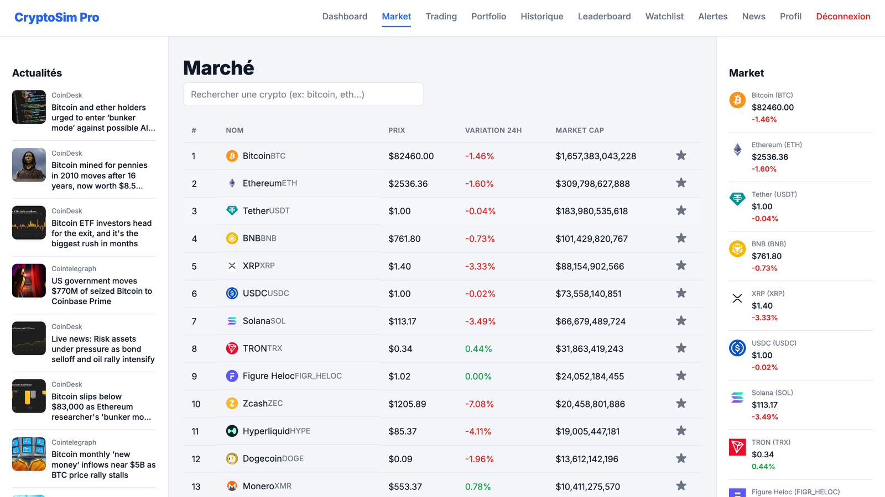
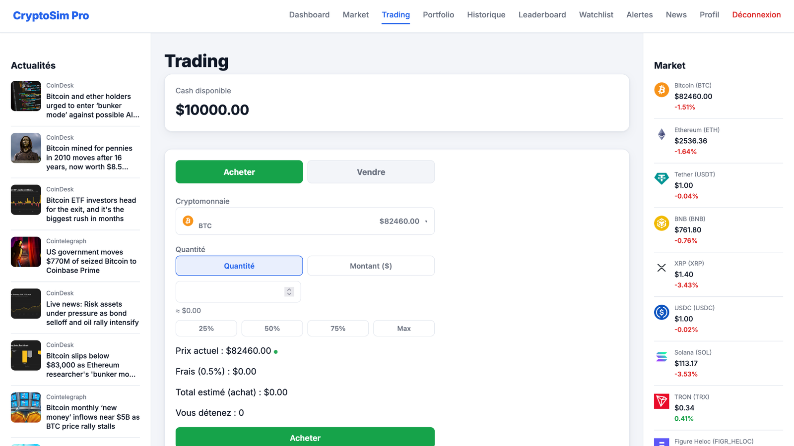
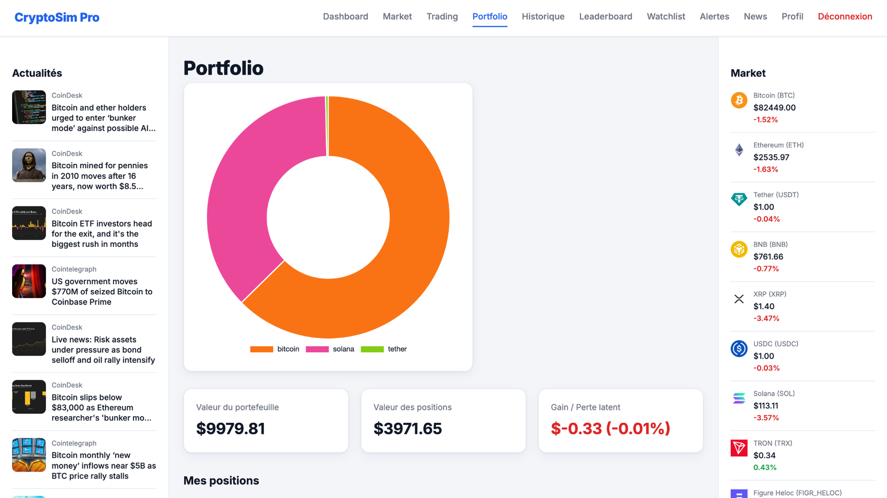
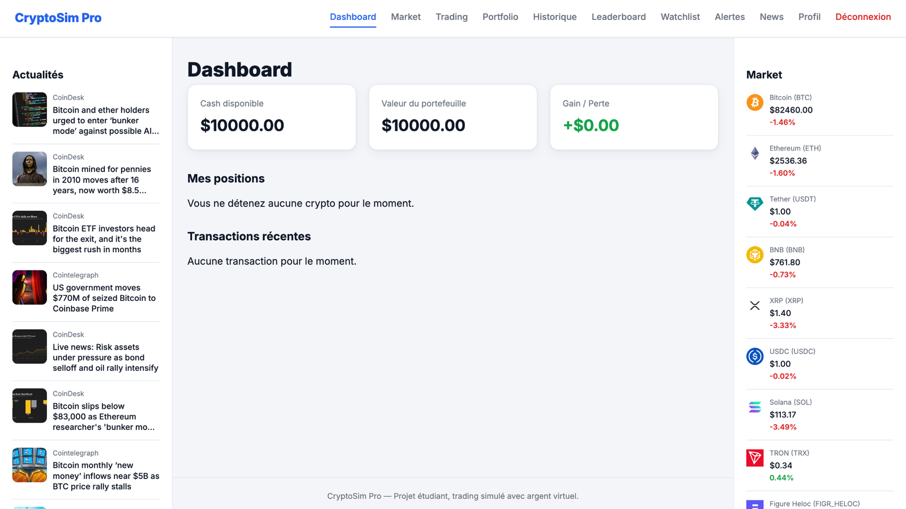
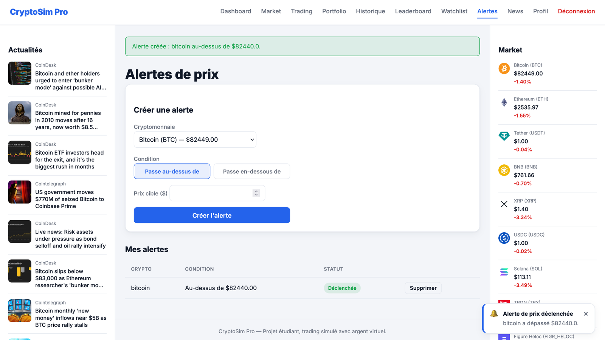
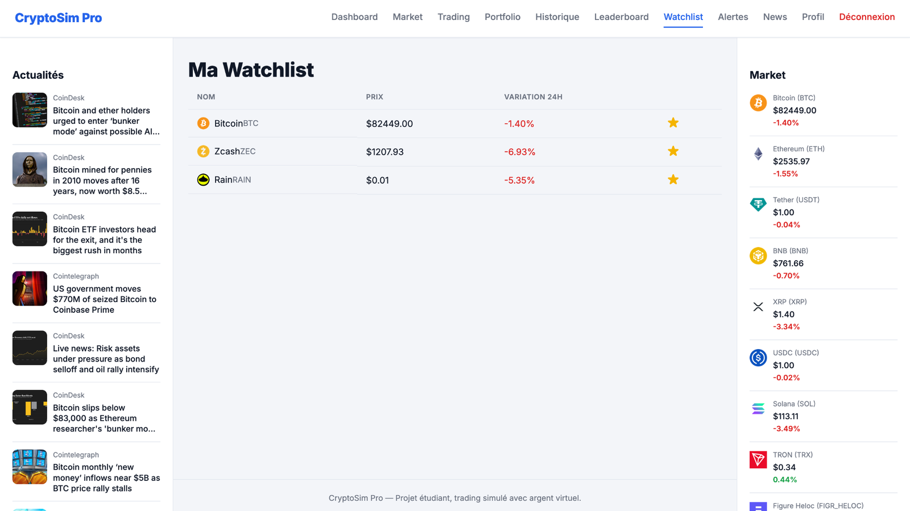
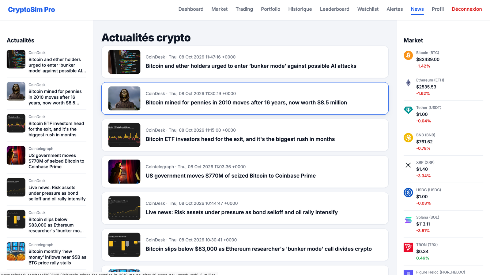
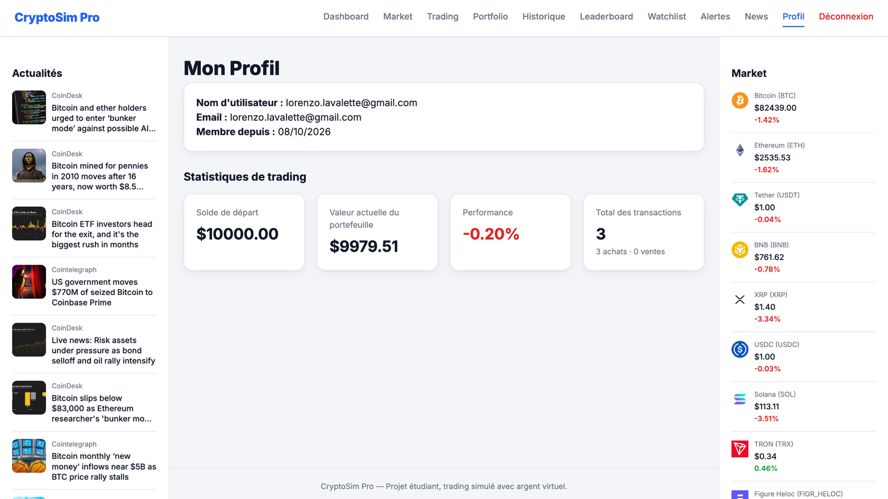

# CryptoSim Pro

A web platform to trade the top 20 cryptocurrencies with virtual money, using live market prices from the CoinGecko API.

Each new user starts with a virtual balance of $10,000 and can buy and sell coins, follow a portfolio's performance, set price alerts and compare results with other users.



## Features

- Live market data for the top 20 cryptocurrencies by market capitalisation, with 7-day price charts
- Buy and sell orders executed at the current market price, with a 0.5% trading fee
- Portfolio tracking with average buy price, current value and profit and loss per position
- Full transaction history
- Watchlist and price alerts (above or below a target price)
- Leaderboard ranking users by total portfolio value
- Crypto news feed aggregated from CoinDesk and Cointelegraph
- User accounts with registration, login and hashed passwords

## Tech stack

- Backend: Python, Flask, Flask-SQLAlchemy, Flask-Login
- Database: SQLite
- Frontend: HTML, CSS, JavaScript
- External data: CoinGecko API (market data), RSS feeds (news)
- Tests: pytest

## Architecture

The application follows the Flask application factory pattern, with one blueprint per feature:

```
app/
  auth/         registration and login
  market/       market overview and CoinGecko client (with response caching)
  trading/      buy and sell engine
  portfolio/    positions and performance
  history/      transaction history
  watchlist/    followed coins
  alerts/       price alerts
  leaderboard/  user ranking
  news/         RSS news feed
  models.py     User, Holding, Transaction, Watchlist, PriceAlert
tests/          pytest suite for authentication and trading
```

Calls to the CoinGecko API are cached (60 seconds for prices, 5 minutes for charts) to stay within the free tier rate limit. If the API is unavailable, the application falls back to the last cached data.

## Getting started

Requirements: Python 3.10 or later.

```bash
git clone https://github.com/LorenzoLeMoineau/cryptosim_pro.git
cd cryptosim_pro
python -m venv venv
source venv/bin/activate        # On Windows: venv\Scripts\activate
pip install -r requirements.txt
```

Create a `.env` file at the root of the project:

```
SECRET_KEY=change-me
```

Run the application:

```bash
python run.py
```

The application is then available at http://127.0.0.1:5000.

To run the tests:

```bash
pytest
```

## My role

This was a group project of three students at EFREI Paris (2026). I led the project, split the work between the team members, and was in charge of:

- the application architecture and the data model
- the buy and sell engine (balance and holdings checks, fees, average buy price)
- the integration of the CoinGecko API
- the tests of the trading module
- the final integration and debugging of the application

## Screenshots

The user interface is in French.

### Trading
Buy or sell a coin by quantity or by amount, with a live estimate of the fee and the total cost.



### Portfolio
Allocation chart, total portfolio value and unrealised profit and loss.



### Dashboard
Overview of available cash, portfolio value, positions and recent transactions.



### Price alerts
Alerts are checked against live prices and trigger a notification when the target is reached.



### Watchlist



### News feed



### Profile and trading statistics



## Disclaimer

This is an educational project. No real money or real cryptocurrency is involved.
